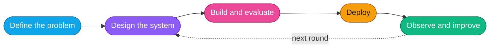

 

## The short version

I'm an AI systems engineer in Bengaluru. I build the parts of an AI product that sit around the model: the agent loop, retrieval, the API, the queue, and the cloud it all runs on.

What I care about most is what happens when something goes wrong. Models time out, providers return half an answer, a person approves the wrong thing. I design for those days first.

| Field | Detail |
| :--- | :--- |
| **Role** | AI Systems Engineer |
| **Works on** | LLM agents, retrieval-augmented generation (RAG), model serving, backend APIs, cloud delivery |
| **Languages** | Python, TypeScript, Go, C++, SQL |
| **Location** | Bengaluru, India |

## Pre-ship checklist

Every AI feature I build has to answer these before it goes out.

- [x] **What can this agent touch?** Tools are scoped per task, and anything that reads untrusted input gets none.
- [x] **Who approves it?** The agent drafts. A person signs off on anything that leaves the building.
- [x] **What does a retry do?** Writes carry idempotency keys, so a second attempt never sends the email twice.
- [x] **What if the outcome is unknown?** When a provider times out mid-write, a reconciliation job checks what happened instead of guessing.
- [x] **Where did this answer come from?** Every claim links back to the passage that supports it.
- [x] **How would I know it's wrong?** Traces, audit logs and evals, so a mistake shows up on a dashboard and not in a customer's inbox.

## Where I can help

- **"The demo works. Production doesn't."**
  - I turn a prototype into a service: proper APIs, a real data layer, deployment, and monitoring you can read at 2 a.m.
- **"The agent has too much power."**
  - Scoped tools, approval steps for anything irreversible, and an audit trail of what it did and why.
- **"Nobody trusts the answers."**
  - Retrieval that cites the passage behind every claim, plus evaluation so quality is measured and not assumed.
- **"The backend falls over under load."**
  - Async workers, queues, caching, and service boundaries that stay clean as the system grows.
- **"Only one person knows how to run it."**
  - Containers, infrastructure as code and runbooks on AWS or GCP.

## How a project moves

In words: define the problem, design the system, build and evaluate it, deploy, then observe and improve. What I learn in the last step feeds the next round of design.

## What I build with

| Area | Tools |
| :--- | :--- |
| **Languages** |      |
| **AI / ML** |      |
| **Backend** |     |
| **Data** |    |
| **Cloud** |       |

## Get in touch

> [!TIP]
> Email is the fastest way to reach me: [harshilmakhija@outlook.com](mailto:harshilmakhija@outlook.com)

<!--
Owner: Harshil. Last reviewed: 2026-10-14.
Review when: role or employer changes, a new job search starts, a major launch or talk, or the stack list stops matching real work.
Badges are static shields.io images (no live data). Banner and dividers are profile/assets/*.svg. Pins are set by hand on the profile page.
-->
