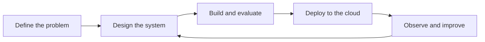

# Harshil Makhija

**AI Systems Engineer** · LLM agents · RAG · Backend · Cloud

I build AI systems that hold up after the demo: agents that stay inside their limits, retrieval you can verify, and the backend and cloud work underneath.

[Email](mailto:harshilmakhija@outlook.com) · [LinkedIn](https://www.linkedin.com/in/harshil-makhija/) · [X](https://twitter.com/MakhijaHarshil) · [Hugging Face](https://huggingface.co/HarshilMaks)

- **Focus:** LLM agents, retrieval-augmented generation (RAG), model serving, backend APIs, cloud-native delivery
- **Works in:** Python, TypeScript, Go, C++, SQL
- **Based in:** Bengaluru, India

---

## About

Most of my work sits between the model and the user: the orchestration, data and infrastructure that decide whether an AI feature is dependable. I take a problem from design through deployment, and I judge a system by how it behaves on its hundredth day in production, not only in its first demo.

I work from engineering fundamentals and a product mindset: clear service boundaries, honest data flow, and code that someone else can read, test and extend.

---

## Focus Areas

**LLM agents and multi-agent systems**
Orchestration, tool use and workflows where an agent proposes and a person approves anything that changes the outside world.

**Retrieval and RAG pipelines**
Vector search and retrieval tuned for relevance, with answers that point back to sources you can open and check.

**Model serving and LLMOps**
Models behind reliable APIs, with experiment tracking, deployment and the monitoring needed to keep them healthy.

**Backend APIs and system design**
REST and gRPC services, async workers and event-driven designs, built on PostgreSQL and Redis.

**Cloud-native architecture**
Containerised, reproducible delivery on AWS and GCP, with infrastructure defined as code.

**Deep learning and computer vision**
Model building and fine-tuning in PyTorch, from classification to geospatial imagery.

---

## Where I Can Help

- **Taking an AI prototype to production:** turning a working demo into a service with proper APIs, data stores, deployment and monitoring
- **Building agent and retrieval systems:** the orchestration, tool access and approval flow, plus retrieval that cites its sources
- **Designing backends for AI workloads:** async processing, queues, caching and service boundaries that stay maintainable as they grow
- **Serving and operating models:** packaging, deploying and tracking models so they run reliably and keep improving
- **Setting up cloud delivery:** repeatable, containerised infrastructure on AWS or GCP, defined as code

---

## How I Work

In words: define the problem, design the system, build and evaluate it, deploy to the cloud, then observe and improve, looping back into design. Every step ends in something measurable, so the next decision rests on evidence.

---

## Principles

| Principle | What it means in practice |
| :--- | :--- |
| **Reliability** | Systems that hold up under real usage |
| **Scalability** | Infrastructure that grows without friction |
| **Maintainability** | Clear, modular, testable code |
| **Performance** | Faster inference, sharper retrieval, efficient design |
| **Impact** | Practical solutions powered by modern AI |

---

## Technical Skills

| Area | Technologies |
| :--- | :--- |
| **Languages** | Python · TypeScript · Go · C++ · SQL |
| **AI / ML** | LLM agents · RAG · multi-agent systems · PyTorch · Transformers · LangChain · LlamaIndex · MLflow |
| **Backend** | FastAPI · NestJS · Celery · REST · gRPC · microservices · event-driven architecture |
| **Data** | PostgreSQL · Redis · vector databases |
| **Cloud & Infrastructure** | AWS · GCP · Docker · Terraform · Cloudflare · Vercel |

---

## Connect

> [!TIP]
> Email is the fastest way to reach me: [harshilmakhija@outlook.com](mailto:harshilmakhija@outlook.com)

Elsewhere: [LinkedIn](https://www.linkedin.com/in/harshil-makhija/), [X](https://twitter.com/MakhijaHarshil) and [Hugging Face](https://huggingface.co/HarshilMaks).

*Always learning. Always building.*

<!--
Owner: Harshil. Last reviewed: 2026-10-14.
Review when: role or employer changes, a new job search starts, a major launch or talk, or the stack list stops matching real work.
Pins are set by hand on the profile page, not in this file.
-->
